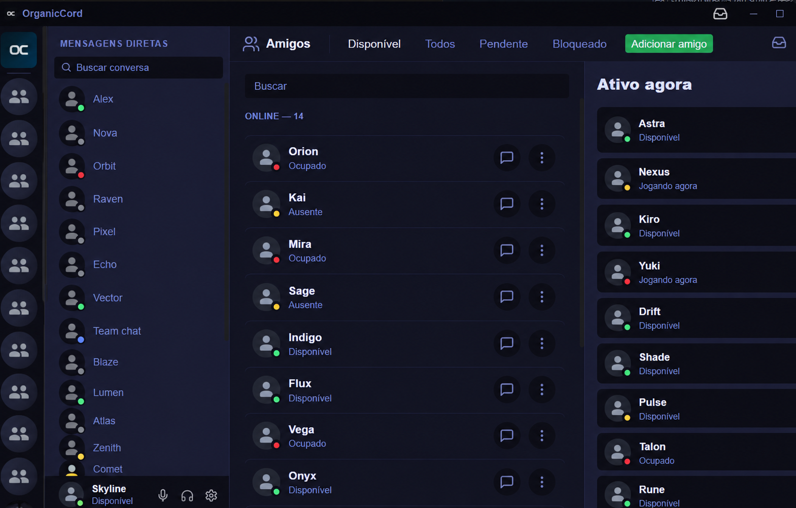

<h1>
  
  OrganicCord
</h1>

Um cliente leve e multi-conta para Discord, de código aberto, construído com Tauri, Rust, React e TypeScript. Este fork dá suporte ao Linux, com build `AppImage`.

> [!WARNING]
> OrganicCord é um cliente **não oficial** do Discord. A Discord não oferece uma API pública completa para clientes de usuário, então mudanças no serviço podem afetar a compatibilidade. Não use este projeto para automação de contas, spam, coleta de dados ou self-bots. Mantenha o cliente oficial do Discord disponível para contas importantes.

<p align="center">
  
</p>

*An anonymized preview of the OrganicCord Friends interface.*

## Beta status

OrganicCord é publicado na [página de releases deste fork](https://github.com/LucianoSkx/OrganicCord/releases). Esta release expande o cliente leve com processamento de voz melhorado, presença de jogos e uma experiência de chat mais responsiva. Não pretende igualar todos os recursos do cliente oficial do Discord.

| Available now | Not available yet |
| --- | --- |
| Messages, DMs, servers, friends, and presence | Video calls |
| Voice calls in DMs and voice channels | Screen sharing / Go Live |
| Attachments, reactions, replies, polls, and forums | Activities, soundboard, and Stage Channels |
| Native notifications, themes, shortcuts, and multi-account sessions | Automatic updates and official macOS support |

## Windows

Este fork dá suporte apenas ao Linux. No Windows, use o instalador do [projeto original](https://github.com/aMathyzinn/OrganicCord/releases) — não é assinado, então o Windows pode avisar sobre publicante desconhecido. Verifique o SHA-256 antes de instalar e não desative recursos de segurança para rodar o app.

## Instalar no Linux (suporte de primeira classe)

A build Linux produz `AppImage`. Voz, gateway, anexos, notificações, multi-conta e login por QR estão funcionando; detecção de jogos também corresponde a processos Linux/Proton. Compartilhamento de tela não está disponível em nenhuma plataforma ainda.

1. Baixe o `OrganicCord_<versão>_amd64.AppImage` da [página de releases](https://github.com/LucianoSkx/OrganicCord/releases) e torne-o executável: `chmod +x OrganicCord_*.AppImage`.
2. Mantenha o stack de portal de desktop disponível para notificações e ícone da bandeja. A bandeja precisa de `libayatana-appindicator` / `libappindicator-gtk3`; sem ele o app ainda inicia, só sem a bandeja.
3. Rich Presence via `discord_ipc` funciona quando o Discord Desktop roda na mesma máquina (expõe o mesmo IPC sobre sockets Unix).

Diagnostic logs go to `$XDG_STATE_HOME/OrganicCord/logs` (`$HOME/.local/state/OrganicCord/logs` by default). If the system keyring (secret-service/KWallet) is unavailable, the encryption key falls back to a file restricted to the user (`$XDG_DATA_HOME/OrganicCord/encryption_key`, mode `0600`), and the app logs a warning on startup.

## O que você pode fazer

### Conversas e comunidades

- Use multiple Discord accounts from one application and switch between them quickly.
- Browse servers, organize them into folders, and access text, voice, and forum channels.
- Send, reply to, edit, and delete your own messages.
- Upload files and images, record voice messages, and view embeds.
- Use emojis, reactions, polls, pinned messages, search, and Markdown formatting.
- Chat through DMs, archive conversations, and view typing indicators, presence, and profiles.
- Manage friends, block users, and create server invites when you have permission.

### Voice

- Start, receive, answer, and decline direct-message voice calls.
- Join and leave server voice channels.
- Select audio input and output devices, test the microphone, and enable RNNoise suppression.
- Mute, deafen, follow participants, and inspect the active connection state.

Voice transport uses Opus. A call is only treated as connected after the voice gateway, encrypted transport, and DAVE protection have completed their negotiation; a visible UI state alone is not proof of a working call.

### Desktop experience

- Receive native notifications, mention alerts, and unread indicators.
- Mute servers, channels, or users for a chosen duration.
- Customize themes, contrast, density, message size, app icon, and keyboard shortcuts.
- Update your avatar, bio, and profile color. Image banners remain subject to Discord account eligibility.
- Detect supported local games and publish a basic “Playing” presence directly through the active OrganicCord account, without requiring Discord Desktop.

## Technical architecture

```text
React + TypeScript + Zustand
        │ UI and local state
        ▼
Tauri 2 — typed commands and events
        │
Rust — sessions, REST, Gateway, permissions, voice, and files
        │
Discord API v10 · Gateway · Voice Gateway
```

| Layer | Responsibility |
| --- | --- |
| React + Zustand | Interface, navigation, message cache, and call state. |
| Tauri | Typed bridge between the frontend and native OS capabilities. |
| Rust | Sessions, REST, Gateway handling, rate limits, permissions, audio, and attachment handling. |
| Gateway v10 | Real-time events, heartbeats, reconnection, and session resume. |
| Voice | Opus, audio devices, encrypted RTP transport, and fail-closed DAVE negotiation. |

Permissions are evaluated across server, role, member, and channel overrides. Request limits are coordinated per route, with separate handling for global rate limits.

## Security and privacy

- The frontend does not receive or persist Discord account tokens.
- Local credentials are encrypted, with keys protected by the operating system.
- Files selected on disk become opaque, temporary identifiers with expiration and size limits before they are uploaded.
- The Content Security Policy restricts script, connection, media, and embedded-navigation origins.
- External links are validated and require confirmation before the default browser is opened.

These measures reduce the attack surface, but do not eliminate the risks inherent to um cliente não oficial. Read the [Security Policy](SECURITY.md) to report vulnerabilities.

## Development

### Requirements

Platform-specific; the Rust toolchain is pinned in [`rust-toolchain`](rust-toolchain).

- **Linux**: `libwebkit2gtk-4.1`, `libgtk-3`, `librsvg`, `libasound2` and `patchelf` for building; `libayatana-appindicator3` / `libappindicator-gtk3` for the tray icon;
- **Ambos**: Node.js 24 (`>=24 <25`) e Rust `1.89.0`.

```bash
# Debian/Ubuntu
sudo apt install libwebkit2gtk-4.1-dev build-essential curl wget file \
  libxdo-dev libssl-dev libayatana-appindicator3-dev librsvg2-dev libasound2-dev patchelf

# Arch
sudo pacman -S webkit2gtk-4.1 base-devel curl wget file openssl \
  xdotool libayatana-appindicator librsvg alsa-lib patchelf
```

### Run locally

```bash
npm ci
npm run tauri:dev
```

Bundle the `AppImage`:

```bash
npm run tauri:build
```

On some distributions linuxdeploy ships an old `strip` that fails on `RELR` sections; build the AppImage with `NO_STRIP=1 npm run tauri:build -- --bundles appimage`.

### Validate the project

```bash
npm run type-check
npm run lint
npm test
npm run build

cd src-tauri
cargo fmt --all -- --check
cargo clippy --all-targets --all-features -- -D warnings
cargo test --all-targets
cargo audit
```

## Documentation and contributing

- [Contributing guide](CONTRIBUTING.md)
- [Security policy](SECURITY.md)
- [Official repository](https://github.com/LucianoSkx/OrganicCord)
- [Creator portfolio](https://damodara.xyz)

Protocol changes should reference official documentation whenever available, include tests, and avoid compatibility claims without real transport, encryption, and media evidence.

## License

OrganicCord is released under the MIT License. The adapted copy of [`hpke-rs`](src-tauri/vendor/hpke-rs) remains under MPL-2.0; see its [`PATCH.md`](src-tauri/vendor/hpke-rs/PATCH.md).
